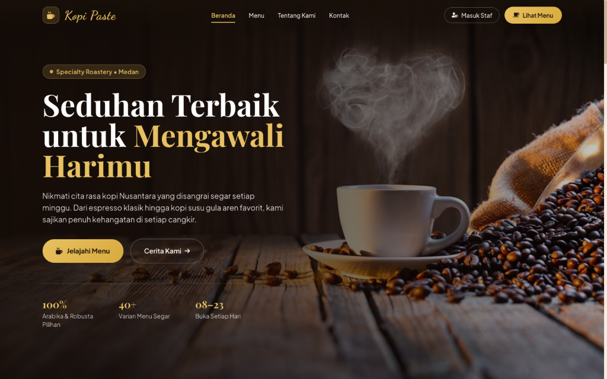

# Kopi Paste — Web Cafe & Sistem Kasir POS


**Kopi Paste** adalah aplikasi web cafe sekaligus sistem kasir Point of Sale (POS) berbasis **Laravel 12** yang dirancang untuk memudahkan pelanggan menjelajahi katalog menu, membantu kasir mencatat pesanan serta mencetak struk dengan cepat, dan memudahkan admin mengelola menu, meja, hingga laporan penjualan harian/bulanan.

---

## Preview Tampilan



---

## Fitur Utama

### Tampilan Publik (Guest)
- **Landing Page Editorial**: Hero bertema roastery, ringkasan keunggulan kedai, menu pilihan dinamis (`$featuredMenus`), carousel testimoni pelanggan interaktif, dan form langganan info promo.
- **Katalog Menu Publik (`/menu`)**: Sticky filter bar dengan kategori dinamis, pencarian langsung (live search), status ketersediaan menu (`Tersedia` / `Habis`), serta modal informasi pemesanan di kasir.
- **Tentang & Lokasi (`/tentang`)**: Cerita brand, visi-misi kedai, fasilitas pendukung, dan informasi kontak lengkap dengan anchor `#contact`.

### Panel Kasir (POS)
- **Dashboard Kasir**: Ringkasan pesanan menunggu/diproses, transaksi & pendapatan hari ini, tab filter pesanan aktif, status okupansi meja, dan daftar menu terlaris harian.
- **Input Pesanan POS (`/cashier/pesanan/create`)**: Tampilan dua kolom responsif dengan pencarian & filter pill kategori, badge kuantitas langsung di kartu menu, toggle **Dine-In / Take Away**, serta ringkasan keranjang & total otomatis.
- **Manajemen Pesanan & Pembayaran**: Filter status pesanan lewat kartu KPI, progress stepper (*Menunggu → Diproses → Selesai*), modal pembayaran (**Tunai**, **Transfer**, **QRIS**, **Kartu Debit/Kredit**) lengkap dengan kalkulator kembalian tunai.
- **Riwayat Transaksi & Struk**: Filter tanggal/metode pembayaran serta tampilan struk cetak bersih siap print (`@media print`).

### Panel Admin
- **Dashboard Eksekutif**: Statistik menu, meja, pesanan aktif, pendapatan harian/bulanan, serta peringkat menu terlaris bulan ini.
- **Kelola Menu & Meja**: CRUD menu beserta preview harga `Rp` dan zona unggah foto interaktif, serta denah kartu meja dengan status (`Tersedia`, `Terisi`, `Reserved`) dan preset kapasitas kursi cepat.
- **Laporan Penjualan (`/admin/laporan`)**: Filter rentang tanggal dengan preset cepat (*Hari Ini*, *7 Hari*, *Bulan Ini*), pemecahan metode pembayaran, penjualan per kategori, Top 10 menu terlaris, grafik batang penjualan harian, pola penjualan 24 jam, **Print Laporan**, dan **Export CSV**.

---

## Teknologi yang Digunakan

| Lapisan | Teknologi |
| :--- | :--- |
| **Backend Framework** | Laravel 12 (PHP 8.2+) |
| **Autentikasi & Role** | Laravel Fortify / Auth Middleware (`admin` & `cashier`) |
| **Template Engine** | Blade Templates |
| **Styling & Ikon** | Tailwind CSS, Custom Design System (`public/css/kopi-paste.css`), Font Awesome 6.4 |
| **Tipografi** | Playfair Display, Plus Jakarta Sans, Dancing Script, JetBrains Mono |
| **Database** | MySQL / MariaDB (direkomendasikan) atau SQLite |

---

## Cara Menjalankan secara Lokal

1. **Clone repository**
   ```bash
   git clone https://github.com/fyou00/kopi-paste.git
   cd kopi-paste
   ```

2. **Install dependensi PHP**
   ```bash
   composer install
   ```

3. **Salin file environment dan buat application key**
   ```bash
   cp .env.example .env
   php artisan key:generate
   ```

4. **Konfigurasi database di `.env`**
   - **MySQL / MariaDB** *(direkomendasikan agar query laporan per-jam `HOUR()` berjalan penuh)*:
     ```env
     DB_CONNECTION=mysql
     DB_HOST=127.0.0.1
     DB_PORT=3306
     DB_DATABASE=kopi_paste
     DB_USERNAME=root
     DB_PASSWORD=
     ```
   - **SQLite** *(opsi cepat untuk coba lokal)*:
     ```bash
     touch database/database.sqlite
     ```

5. **Jalankan migrasi, seeder data awal, dan symlink storage**
   ```bash
   php artisan migrate --seed
   php artisan storage:link
   ```

6. **Jalankan server pengembangan**
   ```bash
   php artisan serve
   ```
   Akses aplikasi melalui browser di `http://127.0.0.1:8000`.

---

## Akun Demo

Tersedia akun bawaan dari `UserSeeder` (di halaman `/login` juga tersedia tombol pengisian otomatis):

| Role | Email | Password |
| :--- | :--- | :--- |
| **Admin** | `admin@kopipaste.com` | `password` |
| **Kasir** | `kasir@kopipaste.com` | `password` |

---

## Daftar Rute Utama

| Akses | Path | Deskripsi |
| :--- | :--- | :--- |
| **Guest** | `/` | Landing page Kopi Paste |
| **Guest** | `/menu` | Katalog menu lengkap per kategori |
| **Guest** | `/tentang` | Profil kedai, visi-misi, dan kontak (`#contact`) |
| **Auth** | `/login` | Halaman login staf (Admin & Kasir) |
| **Kasir** | `/cashier/dashboard` | Dashboard operasional kasir |
| **Kasir** | `/cashier/pesanan/create` | Layar POS pembuatan pesanan baru |
| **Kasir** | `/cashier/pesanan` | Daftar pesanan aktif & penyelesaian pembayaran |
| **Kasir** | `/cashier/transaksi` | Riwayat transaksi & cetak struk |
| **Admin** | `/admin/dashboard` | Dashboard ringkasan manajemen kedai |
| **Admin** | `/admin/menu` | Manajemen daftar & ketersediaan menu |
| **Admin** | `/admin/table` | Manajemen meja & kapasitas kedai |
| **Admin** | `/admin/laporan` | Laporan penjualan, cetak PDF/print, & export CSV |

---

## Tentang Proyek

Proyek ini dikembangkan untuk memenuhi tugas mata kuliah **Workshop Web Lanjut** dengan fokus pada implementasi arsitektur **MVC (Model–View–Controller)** di Laravel 12, pengelolaan basis data relasional (menu, meja, pesanan, dan transaksi), serta pengalaman antarmuka yang responsif baik untuk pengunjung maupun staf operasional kedai.

---

## Lisensi

Proyek ini dilisensikan di bawah [MIT License](LICENSE).

